<div align="center">
  <br/>
  <p>
    
  </p>

  <h1>𝐶𝑎𝑙𝑖𝑠𝑖𝑔ℎ</h1>
  <p><strong>A feature‑rich Midwestern-emo calendar</strong></p>

  <p>
    <a href="https://github.com/Marqed4/calisigh/releases"></a>
    
    
    
  </p>

  <p>
    <a href="#features">Features</a> ·
    <a href="#try-it">Try it</a> ·
    <a href="#install">Install</a> ·
    <a href="#keyboard-shortcuts">Shortcuts</a> ·
    <a href="#under-the-hood">Under the hood</a> ·
    <a href="https://marqed.it/Calisigh">Website</a>
  </p>

  <p>Open it, add your events, choose your themes, and self-loath...</p>

  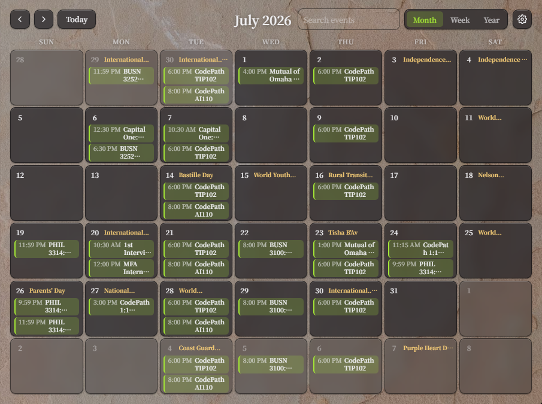
  <br/>
  <br/>
</div>

<table>
<tr>
<td align="center" valign="top" width="25%"><strong>Three views</strong><br/>Month, week and year, one keypress apart.</td>
<td align="center" valign="top" width="25%"><strong>Search that lights up</strong><br/>Every match glows amber on the calendar.</td>
<td align="center" valign="top" width="25%"><strong>Money aware</strong><br/>Type <code>$50</code> and it turns green. Totals add themselves up.</td>
<td align="center" valign="top" width="25%"><strong>A chatbot with opinions</strong><br/>She runs on Ollama, on your own computer.</td>
</tr>
</table>

## Views

<p align="center">
  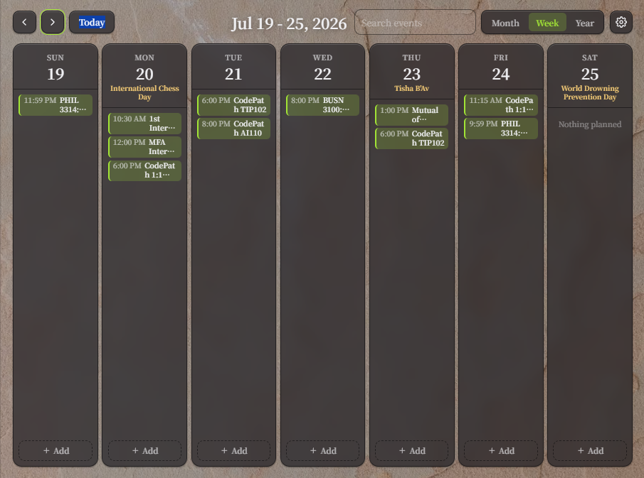
  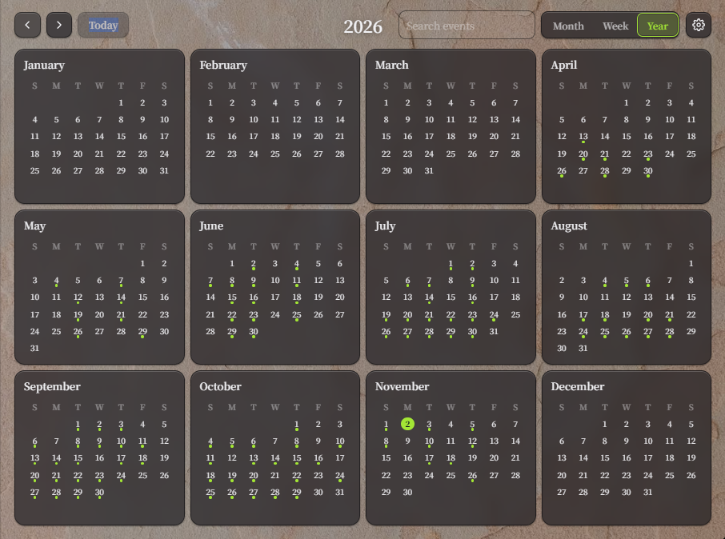
</p>

**Month** is the classic grid, your chaos arranged into neat little boxes. **Week** gives you seven tall columns, every event in order, and an Add button on each day. **Year** puts the whole year on one screen, with a dot under every day that has something on it. Switch with `M`, `W` and `Y`.

## Features

### Your events

<p align="center">
  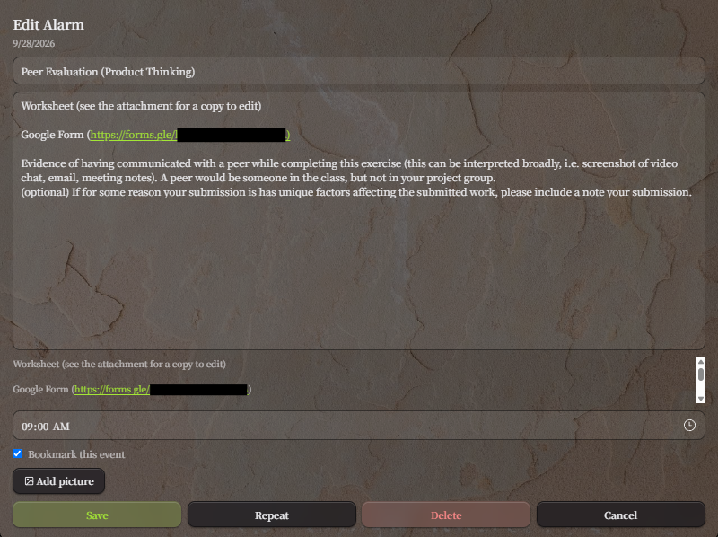
</p>

Create, edit and delete events with more emotion than the situation requires. Repeat an event weekly or yearly until a date you pick, attach a picture to it, and snooze the alarm for 5 or 10 minutes when it goes off. Deleted something by accident? The Undo button stays up for a few seconds.

Events can carry money too. Write an amount like `$150` or `€20` in the title or notes and it turns green as you type, and the add window totals everything you wrote. Web addresses are coloured and become clickable once the event is saved.

<table>
<tr>
<td valign="top">

**The alarm that actually rings**  
A popup, a sound you chose and a volume you set. Stop it, or snooze for 5 or 10 minutes.

</td>
<td valign="top" align="center" width="240">
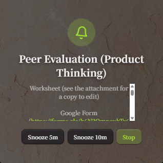
</td>
</tr>
</table>

### Bookmarks and presets

<table>
<tr>
<td valign="top">

Star any event to bookmark it, then jump back to it from the sidebar, right under your upcoming events. Make presets for the kinds of events you keep adding (Class, Gig, Bill Due) with a default colour, font, title and text, then pick one when you add an event.

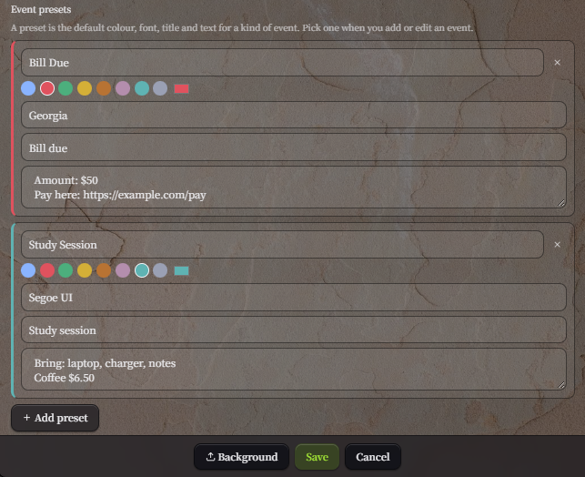

</td>
<td valign="top" align="center" width="210">
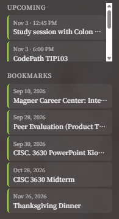
</td>
</tr>
</table>

### Finding things

Press `Ctrl+F` or `/` and type. The search reads titles, notes, times and dates, so `interview`, `9:30 pm`, `nov` or `thursday` all work, and several words must all match. Open **Filters** to limit by date range or time of day. Every day with a match is outlined in amber in the month view, matching events are outlined and the rest fade, and the list shows how many events matched and what they add up to. `Esc` clears it.

<p align="center">
  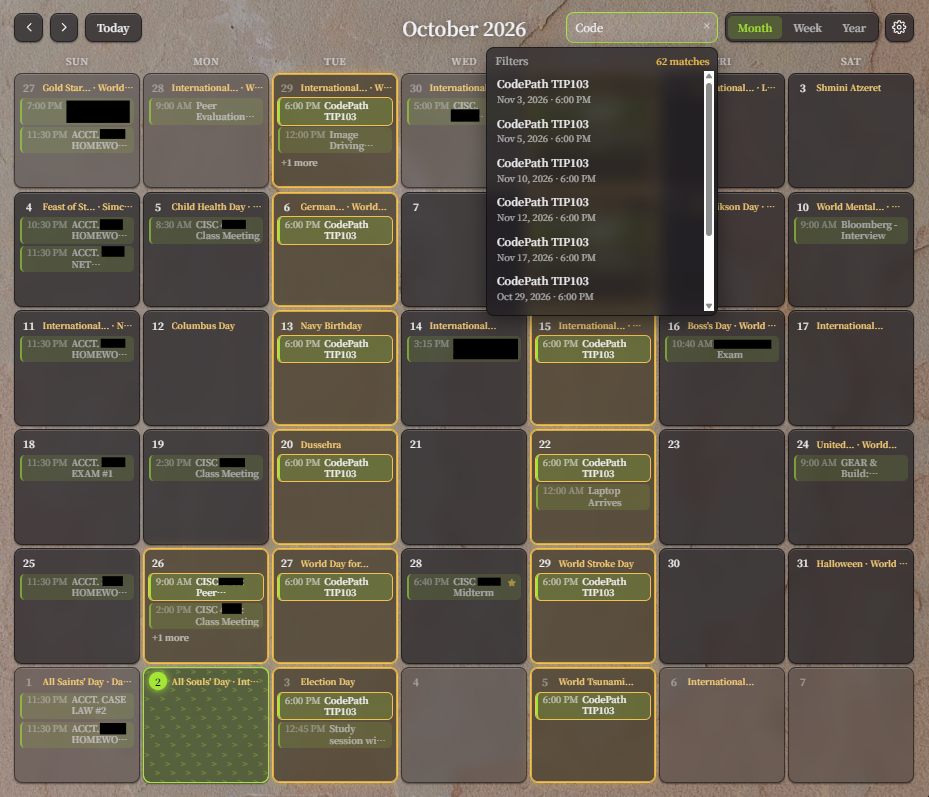
</p>

> [!NOTE]
> Search highlighting works in the month view today. Week and year are on the roadmap.

### The chatbot

A 19‑year‑old from the Midwest who comments on your calendar like it’s a diary you left open. Every so often she suggests an event, and one click puts it on your calendar. Ask her to change or delete an event and she offers a button for that too, and nothing touches your calendar until you press it. Past conversations are saved, and a date range in the sidebar limits which events she can see.

She runs on [Ollama](https://ollama.com) on your own computer, so your schedule never leaves it. She is also handed the money totals, so "how much am I spending this week?" gets a real answer instead of shaky math.

<p align="center">
  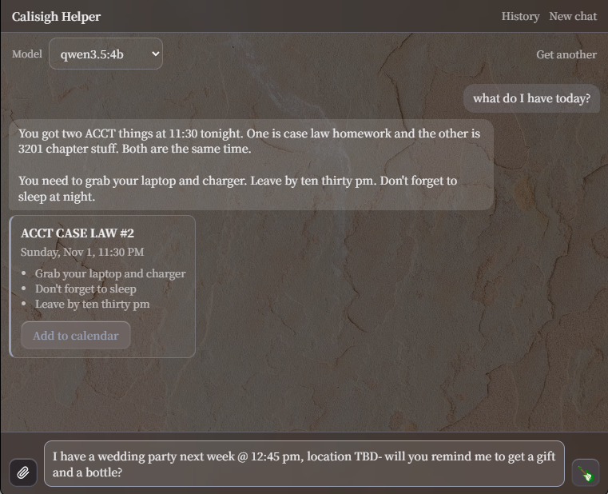
</p>

<!-- TODO when taken: examples/chat/chat-card.png, a change or delete card with its Save the change button
<p align="center"></p>
-->
<!-- TODO when taken: examples/search/money-highlight.png, the search list with "1 match · $36.99"
<p align="center"></p>
-->

- **Pick your own model.** Llama 3.2 is the default, but the chat works with any model Ollama can run. Switch models from the chat window, or type a model name like `mistral` or `gemma2:9b` to download another one. Bigger models are smarter and slower, so choose what your computer can handle.
- **Attach files.** Use the paperclip to give her a text file (txt, md, csv, json, ics) or a picture (png, jpg). The model you picked does the reading, so pictures only work with a vision model such as `llama3.2-vision`, `gemma3` or `llava`. PDF and Word files are not supported.

### Make it yours

<table>
<tr>
<td valign="top">

Your calendar should look and sound like the mood you are in. Pick any font installed on your computer, choose a finish (matte, metallic, plastic, stone, stainless, shimmer, sparkle or glass), a trim colour and an accent colour, or start from a ready-made theme. Cells can be blurred or see-through, soft or sharp.

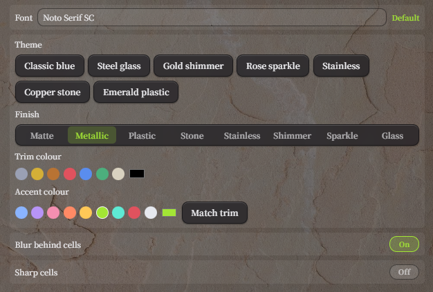

Pick a background picture, or add your own.

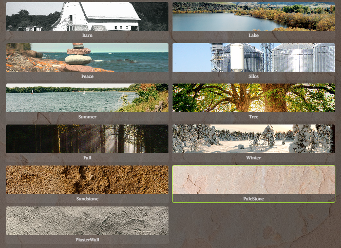

</td>
<td valign="top" align="center" width="150">

**Alert sound**

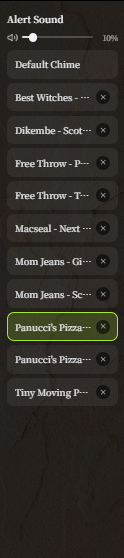

</td>
</tr>
</table>

### Holidays, your way

Federal holidays, observances and religious observances each have their own switch, and a country code sits next to your Calendarific key. Turn off what you don't care about and the calendar gets quieter.

<p align="center">
  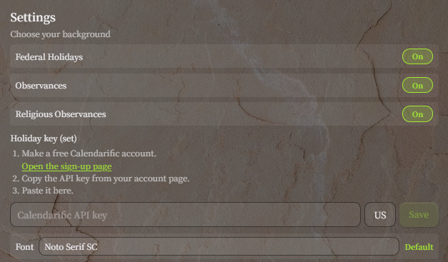
</p>

## Try it

<details>
<summary><strong>Copy these into the app to see what each feature does</strong></summary>

<br/>

Nothing here needs setup beyond Calisigh itself, except the chat prompts, which need Ollama running.

**Add an event.** Click a day, then type these.

| Where | Type this | What you see |
|---|---|---|
| Title | `Rent due $1,200` | `$1,200` turns green, even in the small calendar chip |
| Notes | `Pay $150, parking $12` | Both amounts go green and a line under the box reads "Amounts here add up to $162" |
| Notes | `Dinner $40 and €15` | Different symbols are totalled separately: `$40 + €15` |
| Notes | `Budget $5k` | `k` and `m` work, so this counts as $5,000 |
| Notes | `Map: https://example.com/venue` | The address is coloured as you type, and clickable once the event is saved |
| Repeat | Weekly, then a "Repeat until" date | One event shows up every week until that date |

**Search.** Press `Ctrl+F` or `/`, then type.

| Type this | What it finds |
|---|---|
| `interview` | Any event with that word in its title or notes, in any month |
| `9:30 pm` | Events at that time |
| `nov` or `thursday` | Events in that month or on that weekday |
| `2026-11-05` or `11/5/2026` | Events on that date |
| `gig thursday` | Several words must all match, so only Thursday gigs |
| `$` | Events that mention a dollar amount, with their total shown next to the match count |

**Ask the chatbot.** Open Chat from the sidebar.

| Say this | What happens |
|---|---|
| `what do I have today?` | She reads out your events for the day |
| `how much am I spending this week?` | She quotes the totals Calisigh worked out, instead of doing her own math |
| `I have a wedding party next week @ 12:45 pm, location TBD, will you remind me to get a gift and a bottle?` | She suggests an event, and **Add to calendar** puts it on your calendar |
| `move my dentist to Friday at 3pm` | She offers a **Save the change** button, and nothing changes until you press it |

</details>

## Install

1. **Download the installer.** Grab the `x64-setup.exe` from the [latest release](https://github.com/Marqed4/calisigh/releases/latest) and run it. Calisigh is a Windows app for now.
2. **Install Ollama for the chatbot (optional).** Get it from [ollama.com](https://ollama.com). On first launch Calisigh pulls Llama 3.2 in the background (about 2 GB), and until it finishes she tells you she is still downloading her brain. The calendar works fine without any of this.
3. **Turn on holidays (optional).** Make a free account at [calendarific.com](https://calendarific.com), copy your API key and paste it into the card Calisigh shows on first launch, or into Settings later. Without a key everything else works, there are just no holidays.
4. **Add your first event.** Click any day.

## Keyboard shortcuts

| Key | What it does |
|---|---|
| `M` `W` `Y` | Month, week or year view |
| `←` `→` | Previous or next month, week or year |
| `T` | Jump to today |
| `Ctrl+F` or `/` | Search events |
| `Esc` | Clear the search, or leave the year view |
| `Ctrl` `+` `-` `0` | Zoom every window in, out or back to normal |
| `Enter` / `Esc` | Save or cancel in the add and edit windows |

## Roadmap

Ideas, not promises:

- [ ] Search highlighting in the week and year views, with a month header count in the year view
- [ ] A spending overview for a month, a year or whatever your search found, with totals by tag
- [ ] Search by amount: `>50`, `<=20`, `$100-200`
- [ ] A paid or received checkbox on money events
- [ ] Live highlighting of dates and times as you type
- [ ] The chatbot putting amounts in the notes of events she suggests
- [ ] Export your events and amounts to CSV

## Under the hood

<details>
<summary><strong>How it is built and where your data lives</strong></summary>

<br/>

| Part | What it is |
|---|---|
| Desktop shell | [Tauri](https://tauri.app) |
| Interface | React and Vite, with plain CSS |
| Backend | Java with Spark, serving a local API on port 4567 |
| Storage | SQLite, bundled in the backend jar |
| Chat | [Ollama](https://ollama.com), running on your computer |
| Holidays | [Calendarific](https://calendarific.com) |

- **Everything is stored in SQLite.** Database: `%APPDATA%\Calisigh\Database\Calisigh.db` (macOS: `~/Library/Application Support/Calisigh/Database/`, Linux: `~/.local/share/Calisigh/Database/`). Alarms, your alarm sound list, your backgrounds, the selected sound and the volume all live there; the audio and image files themselves stay in the Calisigh folder and are tracked by relative path, so moving to a new PC or username doesn't break them. On first launch, old text and JSON files (`Events.txt`, `AlarmSounds.txt`, `Backgrounds.json` and so on) are imported once and renamed with a `.migrated` suffix. The SQLite driver is bundled in the backend jar, so users install nothing.
- **Holidays come from Calendarific.** One API call per year, then the result is cached in the same SQLite database, so each year is only fetched once. Offline, years you have already opened still show. You need your own free API key from [calendarific.com](https://calendarific.com). The installer offers to open the sign-up page, and Calisigh asks for the key the first time you open it (you can also add or change it any time in Settings). The key is checked with Calendarific and saved in `config.properties` in the Calisigh app-data folder (`%APPDATA%\Calisigh\` on Windows). Without a key everything else works, there are just no holidays.
- **Search and money live in two small files.** `frontend/src/lib/eventSearch.js` decides what matches, and the dropdown list and the highlighted cells both use it, so they never disagree. `frontend/src/lib/money.js` holds the one pattern for amounts (a symbol, then a number, with optional commas, cents and a `k` or `m` suffix). The highlighting, the search total and the chat context all read it. Sums are done in whole cents. An amount repeated in an event's title and notes counts once.
- **The chat assistant is told the date, a focused slice of your calendar and the totals.** Small models guess when handed a whole calendar and are poor at arithmetic, so the app sends the current date, the events in your chosen range (or today plus 14 days, up to 80 events), each event's amounts, a subtotal per day and a grand total. The assistant never changes your calendar itself: add, edit and delete proposals arrive as cards, and only a button press calls the API.

**Build it yourself.** You need a JDK, Maven, Node and Rust.

```bash
cd backend && mvn clean package
cp target/CustomCalendar.jar ../frontend/src-tauri/target/debug/
cd ../frontend && npm install && npm run tauri dev
```

</details>

## Ethics

Calisigh takes zero liability for your pointless events. Your choices are yours to carry.

## Contributing

If you're considering contributing to Calisigh, first of all, thank you! Check the [Contribution Guidelines](CONTRIBUTING.md) before getting started. Opinions are welcomed. Even the dramatic ones.

## License

Unless specified otherwise, this repository is licensed under [AGPL-3.0](LICENSE).

## Credits

Holiday data by [Calendarific](https://calendarific.com).